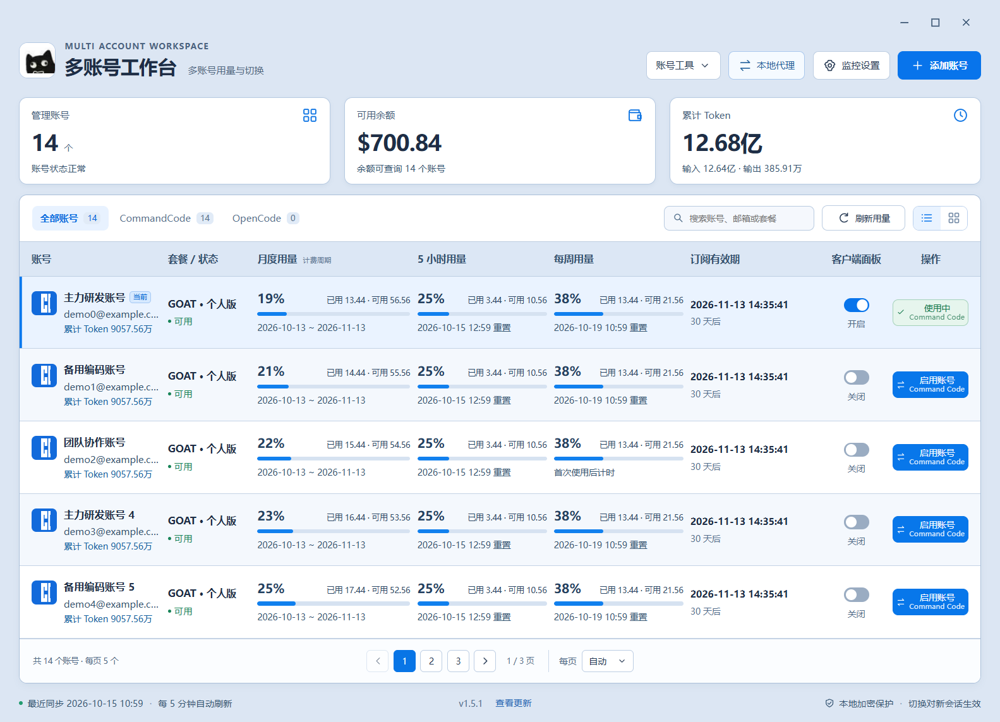
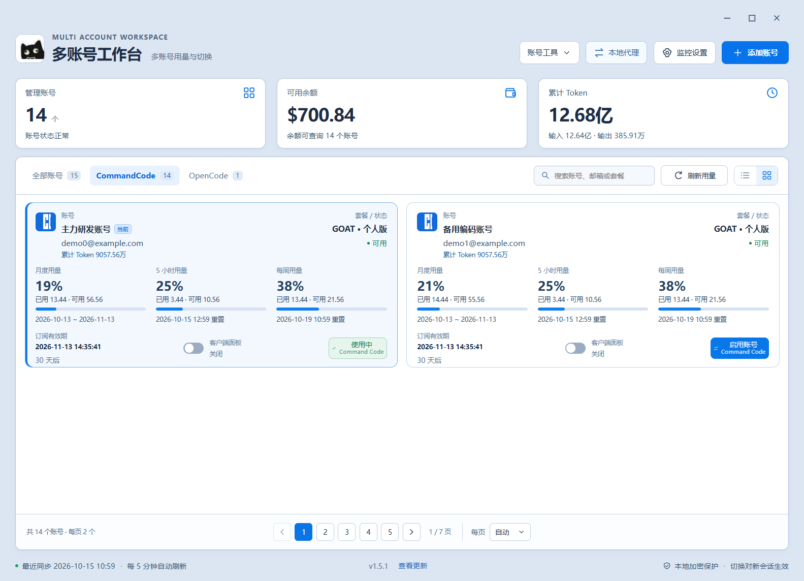
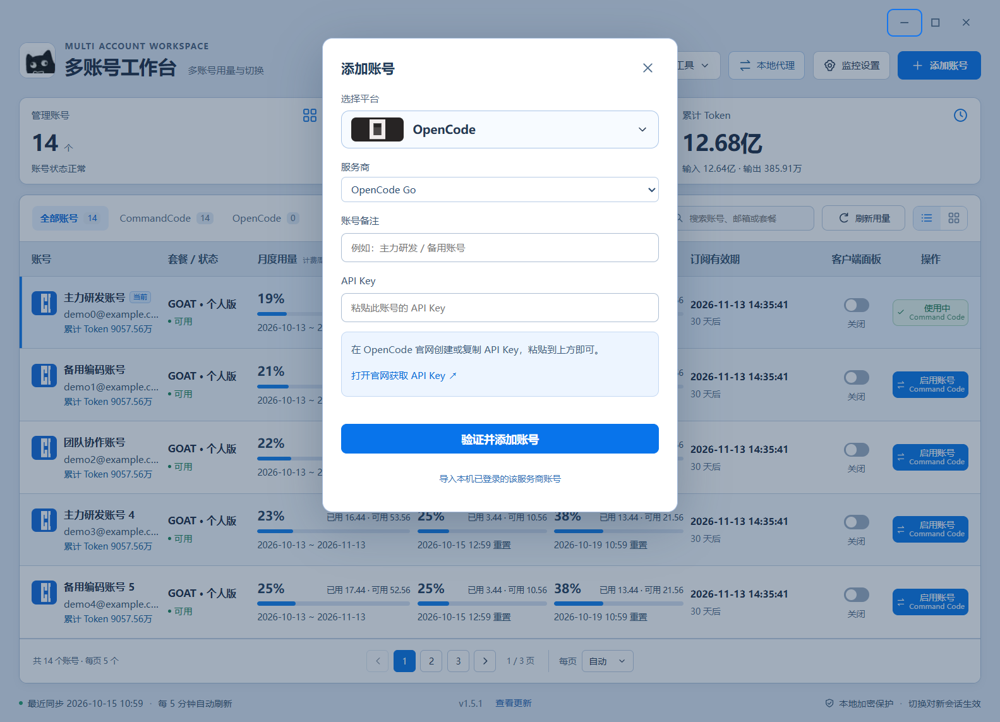
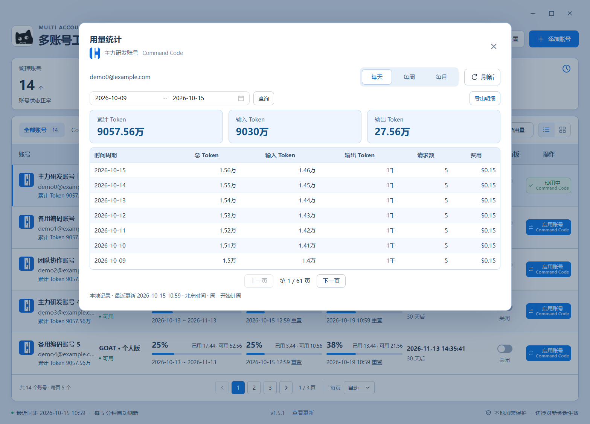
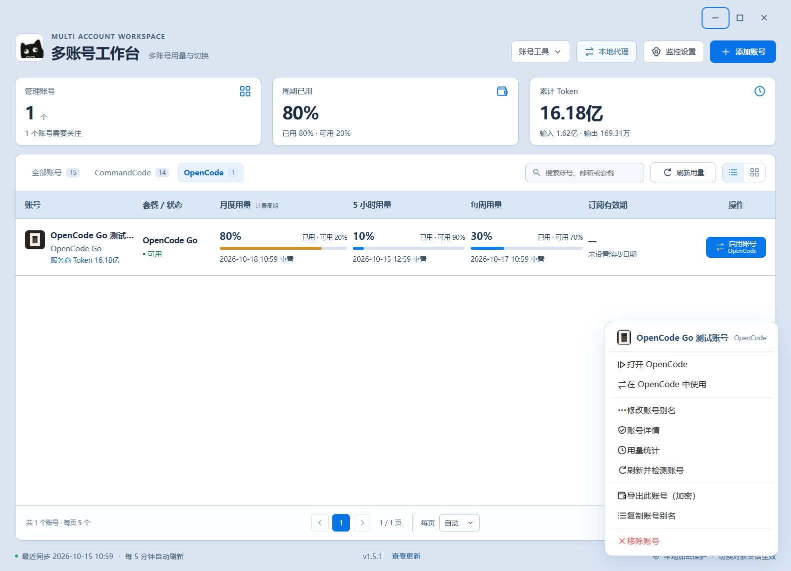
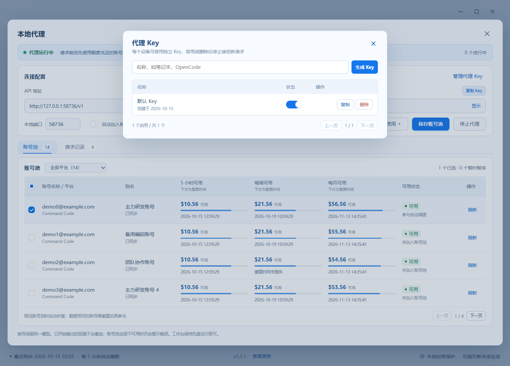
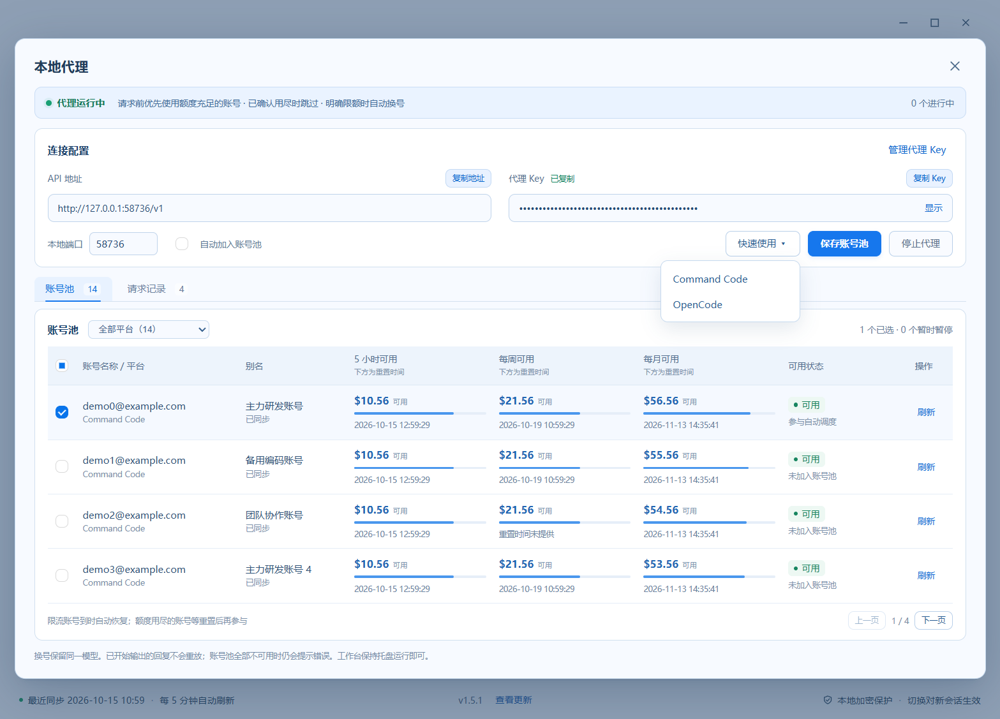

# v1.5.1 界面与操作图

以下均为 v1.5.1 界面，账号、邮箱、余额、Token 和 Key 状态使用模拟数据；不包含个人账号。代理截图的 127.0.0.1 与随机端口仅用于隔离演示，实际程序默认选择正常局域网地址。点击图片可打开原图。

## 账号总览

查看各账号的月度、5 小时、每周用量和订阅有效期。

## 卡片视图

点击“刷新用量”右侧的卡片按钮切换视图；再次点击列表按钮恢复账号清单。

## 添加 OpenCode 账号

点击“添加账号”，选择 OpenCode 和 Go / Zen，粘贴对应账号的 API Key 后验证添加。

## Token 用量统计

右键账号选择“用量统计”，切换每天、每周、每月，选择日期范围后查询或导出明细。

## 账号右键操作

右键账号可打开应用、启用账号、修改别名、查看详情、刷新和加密导出该账号。

## 代理账号池

点击顶部“本地代理”，选择可用账号后开启；可开启“自动加入账号池”，不可用账号不能加入。

## 代理 Key 管理

在本地代理中点击“管理代理 Key”，命名生成 Key，按设备分别启用、禁用或删除。

## 快速使用

开启代理并保存后点击“快速使用”，选择 Command Code 或 OpenCode。客户端已运行时需确认重启；Command Code 重开后选择“工作台代理”模型组。

## 版本归档

本页记录 v1.5.1。更早版本没有保存经核对的对应截图，因此没有用新版界面替代历史截图。后续版本在独立版本目录保存功能图，并随 Release 发布。
